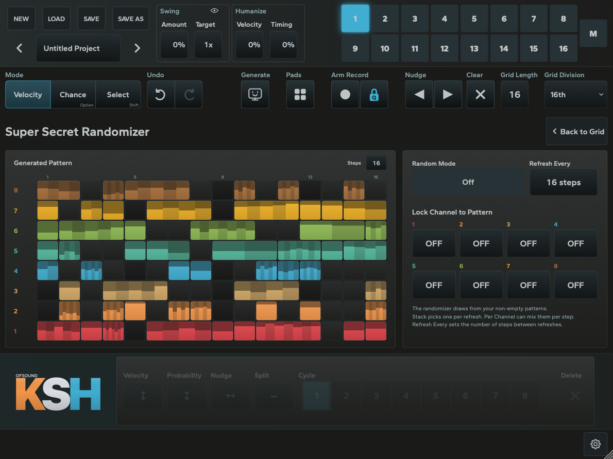

# Super Secret Randomizer archive

Super Secret was a playback randomizer. On desktop it opened from the **S** in the KSH wordmark and covered the step grid. The compact menu had a **Super Secret** tab. The preview displayed the pattern the engine would play.

| Control | Behavior |
| --- | --- |
| Random Mode | **Off** played the selected source. **Stack** picked one nonempty source pattern per refresh. **Per Channel** could mix source patterns across channels and steps. |
| Steps | Set the generated pattern length independently of the selected source pattern. |
| Refresh Every | Set the number of generated steps between refreshes. |
| Lock Channel to Pattern | Fixed an individual channel to a numbered pattern. **OFF** let the randomizer choose. |

The archived controls used the existing `mode`, `generated_steps`, `refresh_steps`, and `channel_lock` engine commands and displayed the generated playback buffer. Those engine commands and their saved project fields still support existing projects. To restore the panel, connect those commands to the controls above and use the generated buffer for the preview.

The separate **Generate** button opens the XY pattern editor. It edits the selected source pattern directly.
